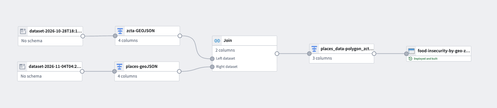
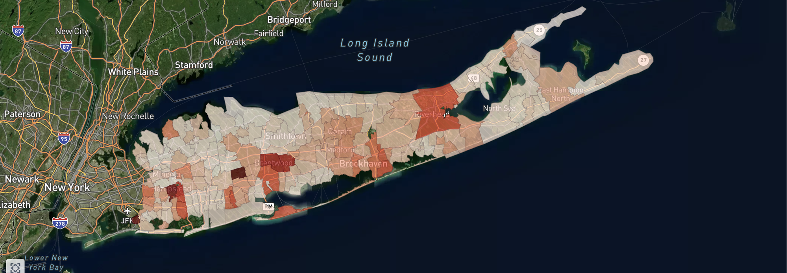
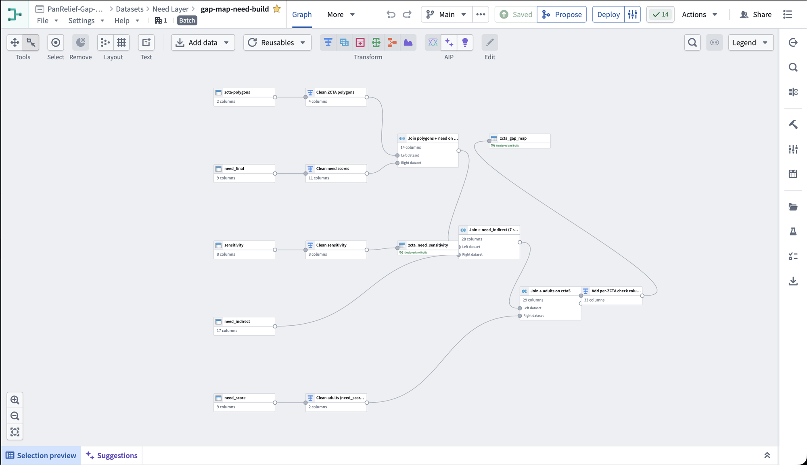

# 2 · Transformations

How the data gets into Foundry and into the shape the Ontology needs. One step runs locally in Python. Everything else runs in Pipeline Builder.

## Local: TIGER shapefile → GeoJSON

Pipeline Builder doesn't read shapefiles, so the ZCTA boundaries are prepared locally. The script is [`shapefile_to_geojson.py`](code/shapefile_to_geojson.py):

1. Read the 2026 TIGER ZCTA shapefile, filtered to the 175 Long Island ZCTAs.
2. Reproject NAD83 → WGS84 (EPSG:4326).
3. Write GeoJSON and upload it to Foundry as `zcta-polygons`.

**Polygons, not points.** The first attempt used one lat/long point per ZCTA. A point can't be shaded as an area, and the map shows a rate per area.

The need model in [1 · Modeling](../1-modeling/) also runs locally. Its outputs (`need_final`, `need_indirect`, `need_score`, `sensitivity`) are uploaded manually. Every source is a public file refreshed yearly or less, so Data Connection wasn't needed.

## v1: PLACES on polygons

The first map. PLACES ships a centroid point per ZCTA, and every value in it is a string. The pipeline:

1. Geo-join the PLACES points to the TIGER polygons, keeping the properties from PLACES and the geometry from TIGER.
2. Extract `zcta5` and the food-insecurity rate, and cast the rate to double.

## Need build: `gap-map-need-build`

The final need pipeline. It produces two outputs:
- `zcta_gap_map`, one row per ZCTA, backing the **ZCTA** object type.
- `zcta_need_sensitivity`.

1. **Clean ZCTA polygons:** pull `zcta5` and the geometry into their own columns.
2. **Clean need scores:** cast types and add the need class label ("1 – Lowest need" … "5 – Highest need", or "Insufficient data").
3. **Join polygons ← need on `zcta5`.** Polygons go on the **left**, so all 175 ZCTAs stay on the map. The 2 with no data show as "Insufficient data", not holes. *(14 columns)*
4. **Join ← `need_indirect`:** the 7 indicator rates and their z-scores, for the data view's indicator chart. *(28 columns)*
5. **Join ← adults (from `need_score`) on `zcta5`:** the denominator for the "enough adults" check. *(29 columns)*
6. **Add per-ZCTA check columns:** pass/fail and the value for each data-health check in the data view. *(33 columns)*
7. **Clean sensitivity → `zcta_need_sensitivity`.** This is kept separate because it backs the weight choice, and the map doesn't need it.

## Supply build

Four raw datasets in the Supply Layer folder. Each one backs one [supply object type](../3-ontology/#supply).

1. **Pantries → `supply_pantries`.** 412 Long Island food pantries and meal sites, loaded from the public map at [map.thefoodpantries.org](https://map.thefoodpantries.org). These become the pantry dots on the supply map.
2. **Synthetic needs.** Each pantry gets a synthetic column of what it needs, has and is short of. No public source has real pantry stock levels, so these counts are illustrative.
3. **Search areas → `supply_search_areas`.** Demo home addresses, each drawn as a circle polygon at 3 and 8 miles: 20 addresses × 2 radii = 40 search areas.
4. **Pantries in range → `supply_pantries_in_range`.** Every pantry inside each circle, with its distance, score parts and rank. That gives 1,461 rows.
5. **Recommendations → `supply_recommendations`.** AIP matches what the donor has ("12 cans of soup, 8 boxes of pasta") against what each pantry in range is short of, and picks a pantry. Each recommendation comes with a one-line instruction. With 5 demo baskets per search area, that is 200 recommendations.
