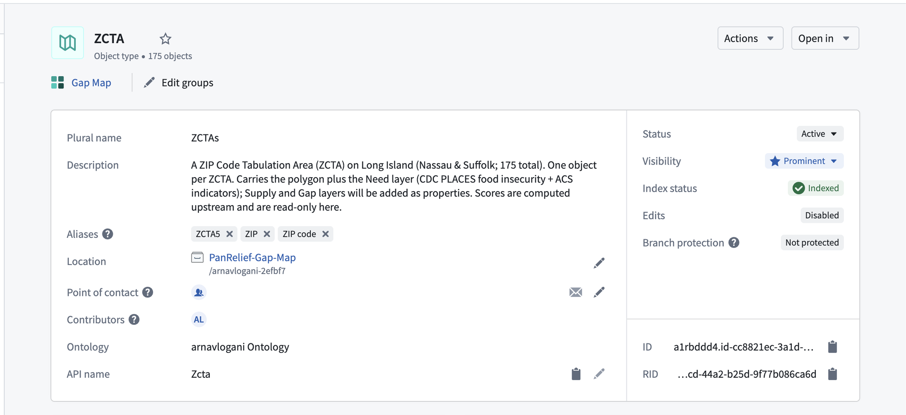
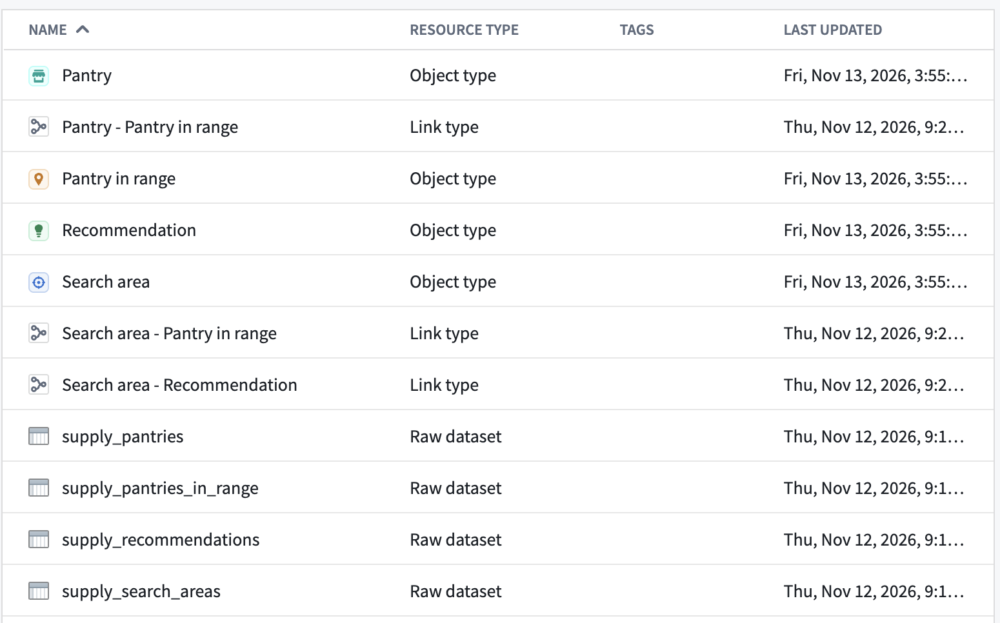
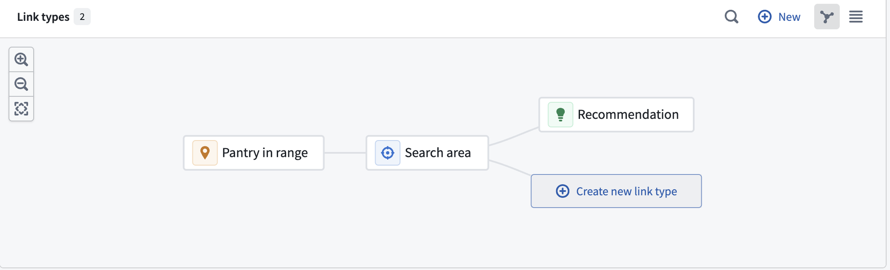
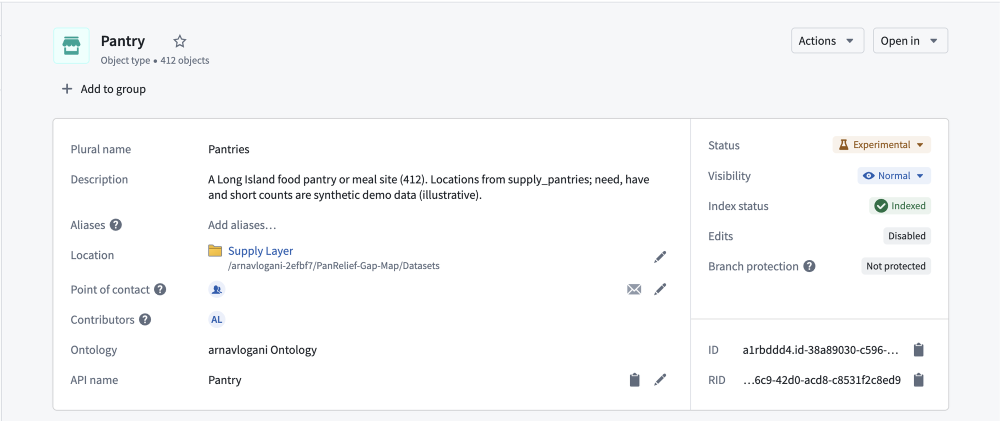
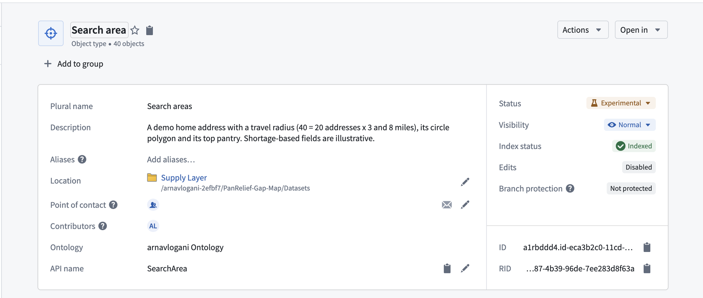
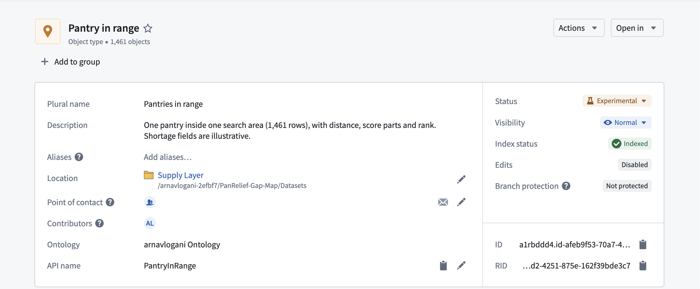
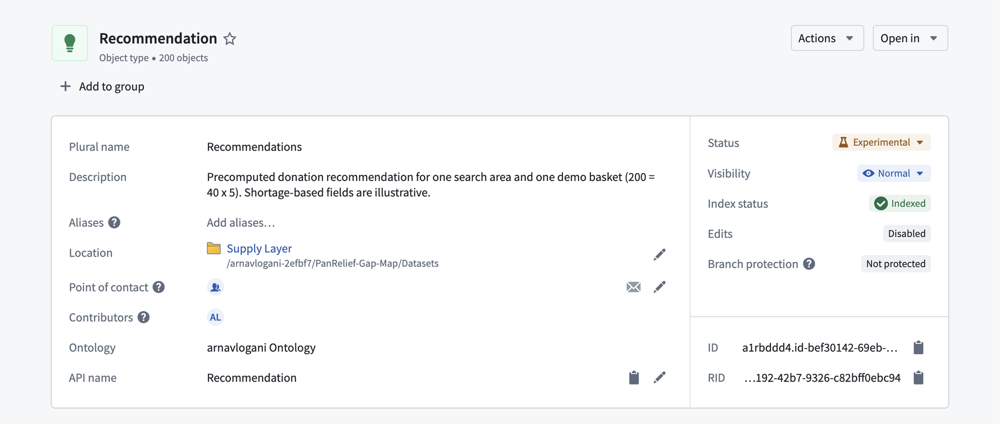

# 3 · Ontology

The object types the Workshop app reads from. One object type covers need, and four cover supply.

## Need: ZCTA

One object per Long Island ZCTA, 175 in total.



- **Backing dataset:** `zcta_gap_map` ([Transformations](../2-transformations/#need-build-gap-map-need-build)).
- **Primary key:** `zcta5`.
- **Geometry:** a geoshape, so the map can shade the polygon directly.
- **Aliases:** ZCTA5, ZIP, ZIP code, for search.
- **Edits disabled.** Scores are computed upstream and read-only here.

**One object type per ZCTA, not one per layer.** Every need measure has the same grain, so each new measure is a new property on the same object. There are no joins between object types on the need side.

| Property group | Properties |
|---|---|
| Identity | `zcta5`, geometry |
| Need | need class, need score, need quintile, `z_direct`, `z_indirect` |
| Scale | food-insecurity rate, estimated food-insecure adults, adults |
| Indicators | 7 ACS rates and their z-scores |
| Data health | low confidence, plus a pass/fail and value for each of the 4 checks |

## Supply



| Object type | Backing dataset | Objects | One object is |
|---|---|---|---|
| **Pantry** | `supply_pantries` | 412 | A Long Island food pantry or meal site, with its location and what it needs, has and is short of |
| **Search area** | `supply_search_areas` | 40 | A home address and travel radius (20 addresses × 3 and 8 miles), its circle polygon, and its top pantry |
| **Pantry in range** | `supply_pantries_in_range` | 1,461 | One pantry inside one search area, with its distance, score parts and rank |
| **Recommendation** | `supply_recommendations` | 200 | The donation recommendation for one search area and one basket (40 × 5) |

Pantry locations are real. Need, have and short counts are synthetic and illustrative.

### Links

```
Pantry ──< Pantry in range >── Search area ──< Recommendation
```

- **Pantry – Pantry in range:** which search areas a pantry falls inside.
- **Search area – Pantry in range:** every pantry within the radius, ranked.
- **Search area – Recommendation:** one recommendation per basket.



**Pantry in range is its own object, not a property.** Distance and rank belong to a pantry *and* a search area together. The same pantry is 2 miles from one home and 7 from another.

| | |
|---|---|
|  |  |
|  |  |
