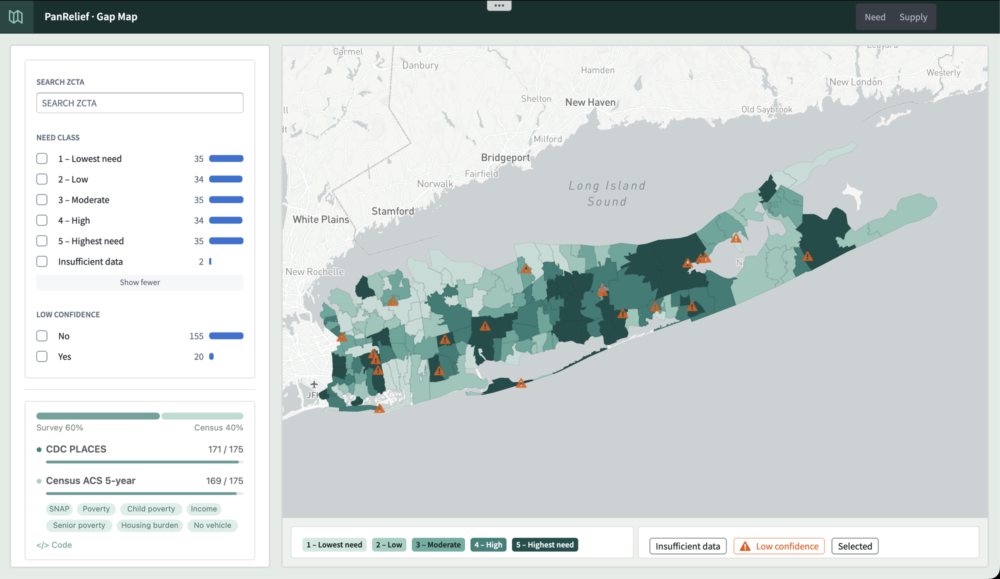
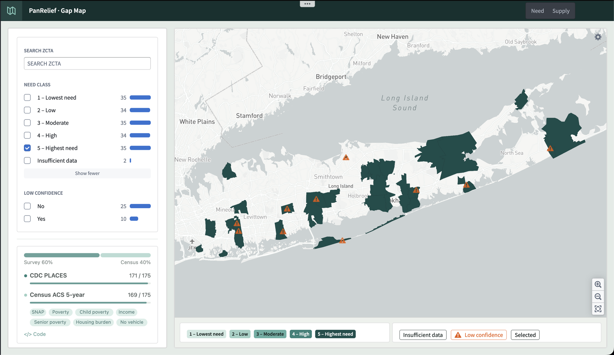
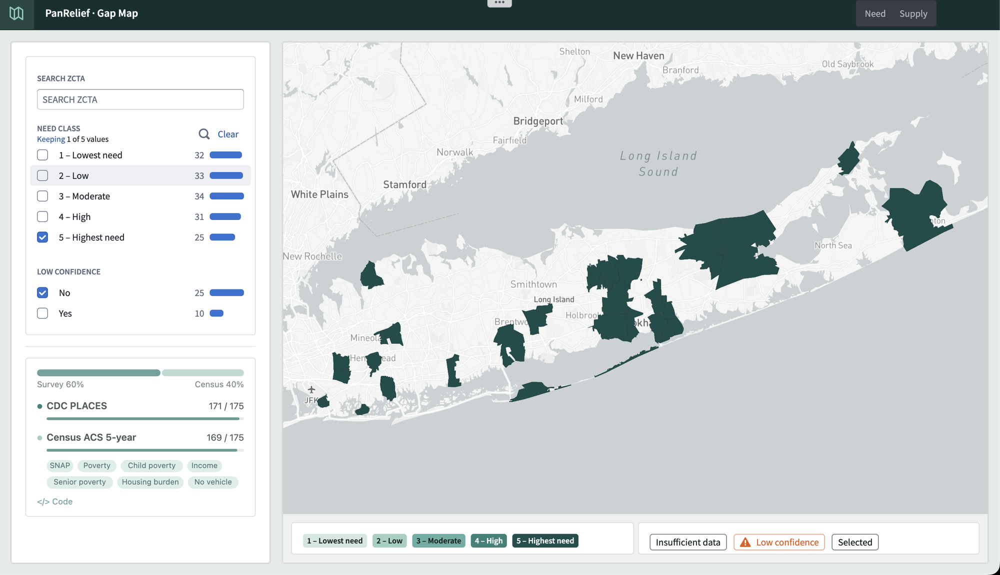
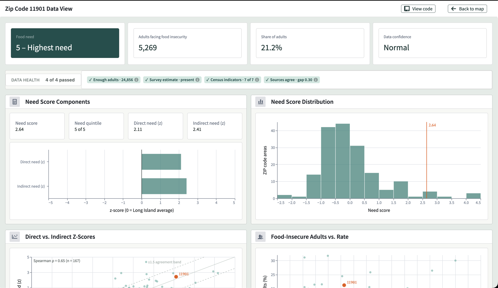
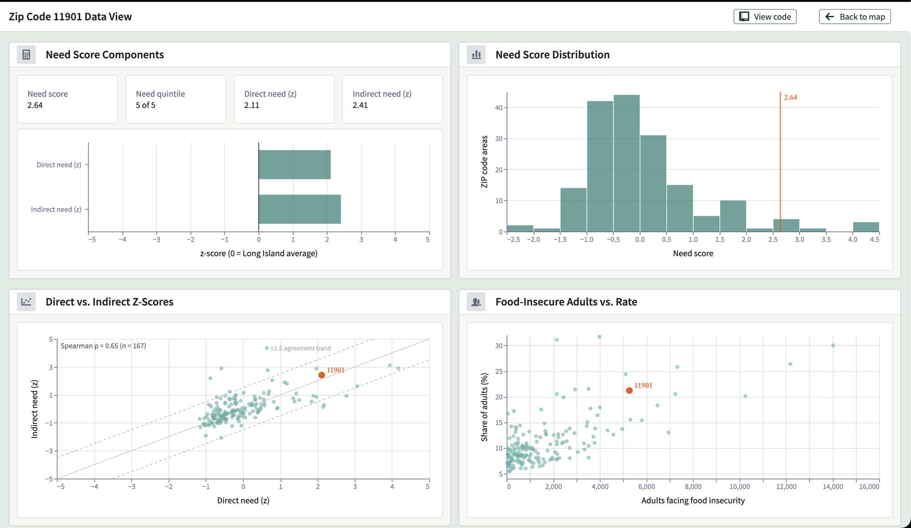
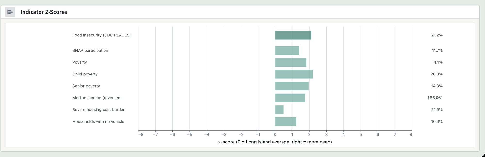
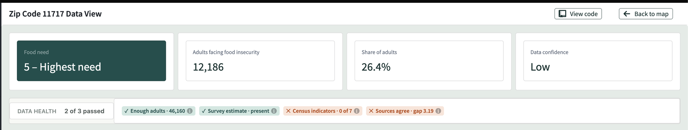
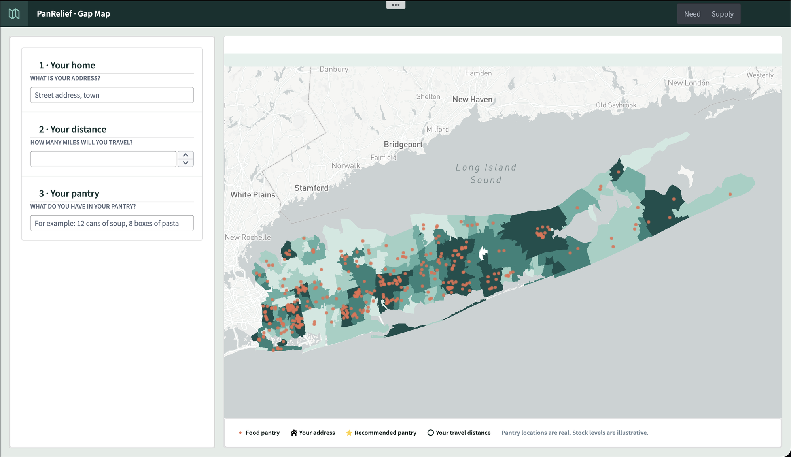
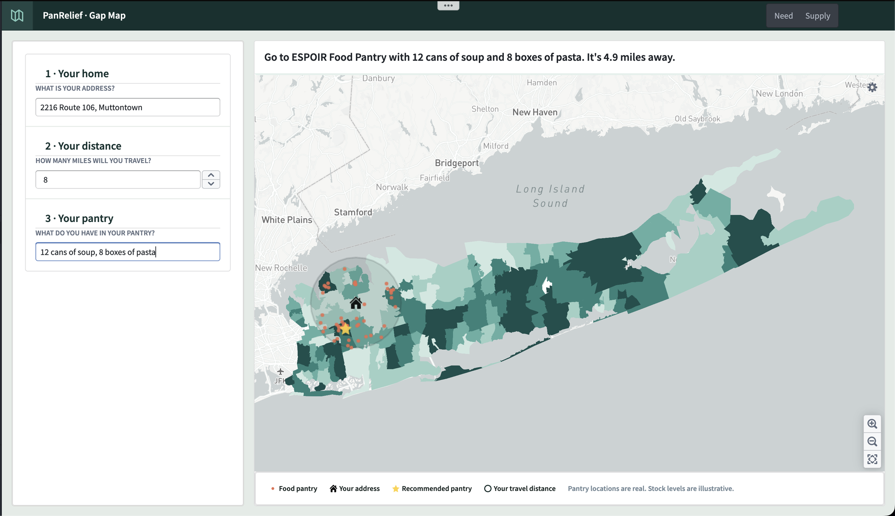
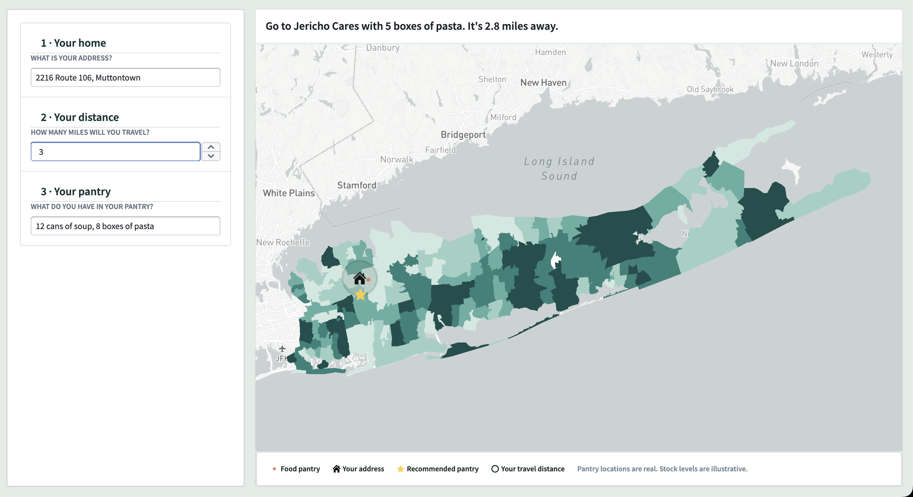

# 4 · Workshop

The PanRelief · Gap Map app has two tabs, **Need** and **Supply**, plus a per-ZCTA **data view**.

## Need

| Widget | What it does |
|---|---|
| **Search ZCTA** | Jumps to one ZIP code area |
| **Need class filter** | Facet list with counts and bars. Filters the map, and its counts update with the other filters |
| **Low confidence filter** | Shows only solid estimates, or only flagged ones |
| **Source panel** | Shows the 60 / 40 survey–census weight, each source's coverage (171 / 175, 169 / 175), and the 7 indicators. `</> Code` links to [Modeling](../1-modeling/) |
| **Map** | ZCTA polygons colored by need class on a 5-step sequential scale, with a warning icon on low-confidence ZCTAs |
| **Tooltip** | ZCTA, need class, food-insecure adults, share of adults, confidence |

**Choropleth, not heatmap.** Foundry's heatmap layer shows point density. This map needs a rate per area.

**Need class, not score.** "Top fifth of Long Island" is easier to act on than a z-score of 1.3.

| Highest need | + confident only |
|---|---|
|  |  |

## Data view

Opened by selecting a ZCTA. `View code` links to the model, and `Back to map` returns to the Need tab.

| Section | Shows |
|---|---|
| **Headline cards** | Need class, food-insecure adults, share of adults, data confidence |
| **Data health** | 4 checks, each with its value: enough adults (≥ 500), survey estimate present, Census indicators (≥ 4 of 7), sources agree (gap < 1.5) |
| **Need score components** | `z_direct` and `z_indirect` as bars on a shared −5 to 5 axis |
| **Need score distribution** | Histogram of all ZCTAs, with this ZCTA marked |
| **Direct vs. indirect** | Scatter of every ZCTA, with the 1:1 line, the ±1.5 agreement band, and Spearman ρ |
| **Food-insecure adults vs. rate** | Scale against intensity: a high rate can mean few people, and a low rate many |
| **Indicator z-scores** | All 8 inputs as z-scores, each with its raw value |

## Supply

| Step | Input |
|---|---|
| **1 · Your home** | Street address. It's geocoded and shown as a house icon |
| **2 · Your distance** | Miles you'll travel. Drawn as a circle around your home |
| **3 · Your pantry** | Free text, e.g. "12 cans of soup, 8 boxes of pasta" |

The map shows every pantry over the need layer. The output is a one-line instruction plus a star on the recommended pantry:

| 8 miles | 3 miles |
|---|---|
|  |  |

**How the recommendation is chosen.** The address and radius select a [Search area](../3-ontology/#supply). Its linked **Pantries in range** become the candidates. AIP then matches the donor's items to each candidate's shortages and returns a **Recommendation**: which pantry, which items, how far. Only the items that pantry is short of go in the sentence. That's why the 3-mile result sends 5 boxes of pasta and no soup.

Pantry locations are real. Shortages are synthetic, and the demo covers 20 addresses × 2 radii × 5 baskets.
