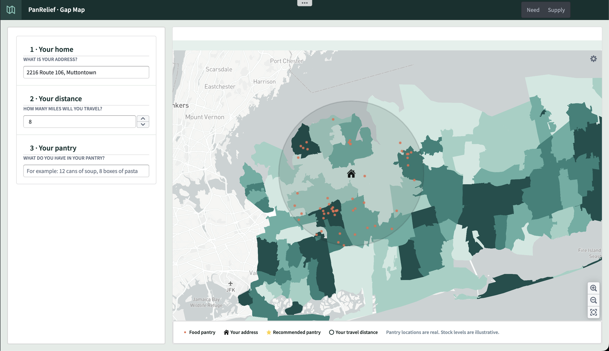

# PanRelief · Gap Map

**Where on Long Island is food needed most, and how do we get it there?**

Gap Map is a Palantir Foundry Workshop app built for PanRelief, a 501(c)(3). It ranks all 175 ZIP code areas in Nassau and Suffolk counties by modeled food need. It then routes donors to a real food pantry near them that can use what they have.

> **Authorship.** I did every line of code, design decision, modeling choice, dataset selection, transformation and piece of problem decomposition in this repo by hand. Claude helped write the markdown files, and Palantir's AI FDE helped build the Workshop app in Foundry. 

---

## Need map

Every ZIP Code Tabulation Area (ZCTA) is shaded by **need class**, from 1 (lowest) to 5 (highest). Each class is a fifth of Long Island. The class comes from one score that blends two kinds of evidence:

- **Survey (60%):** CDC PLACES modeled food-insecurity rate.
- **Census (40%):** seven ACS indicators: SNAP, poverty, child poverty, senior poverty, income, housing burden, no vehicle.

The panel on the left shows how much of Long Island each source covers: PLACES 171 / 175, ACS 169 / 175.

**Low confidence is marked.** A warning icon flags the 20 ZCTAs where data is thin or the two sources disagree. These health checks were done in "1-modeling" code.

### Filter

Pick a need class, a confidence level, or a ZCTA. The facet counts update as you filter: here, the 25 highest-need areas whose estimates are solid.

| Highest need | Highest need, confident only |
|---|---|
|  |  |

---

## ZIP code data view

Click any ZCTA to open its full breakdown.

**Headline and data health.** The page shows the need class, the estimated number of food-insecure adults, the share of adults, and a confidence verdict. Four checks back that verdict, all outlined in 1-modeling

- Enough adults (500 or more)
- A survey estimate exists
- At least 4 of the 7 Census indicators are present
- The two sources agree (Z-score gap under 1.5)

When checks fail, the page says so. Brentwood (11717) is in the highest-need class, but its Census data was suppressed after a 2020 collection error:

**How the score was built.** The data view breaks the score down four ways:

- **Components:** the direct and indirect z-scores.
- **Distribution:** where this ZCTA's score falls among all of Long Island's.
- **Direct vs. indirect:** each ZCTA's two z-scores plotted against each other, with the ±1.5 agreement band.
- **Scale:** the number of food-insecure adults against the rate.

**Every indicator** is shown as its z-score next to its raw value:

---

## Supply: where should my food go?

The supply side is for donors. It takes three inputs:

1. **Your home:** a street address.
2. **Your distance:** how many miles you'll travel.
3. **Your pantry:** what you have to give, in plain text.

The map shows all 412 Long Island food pantries over the need layer, from [map.thefoodpantries.org](https://map.thefoodpantries.org). It draws your search radius. AIP then matches what you have against what each pantry in range is short of, stars the best pantry, and tells you what to bring.

| Pantries over need | Address and radius |
|---|---|
|  |  |

Tighten the radius and the recommendation changes. It sends only what that pantry needs:

*Pantry locations are real. Stock levels are illustrative.*

---

## How it was built

| | |
|---|---|
| [**1 · Modeling**](1-modeling/) | Turning public data into one need score per ZCTA: z-scores, weights, sensitivity tests, null rules |
| [**2 · Transformations**](2-transformations/) | Python preprocessing and Foundry Pipeline Builder graphs |
| [**3 · Ontology**](3-ontology/) | ZCTA for need; Pantry, Search area, Pantry in range, Recommendation for supply |
| [**4 · Workshop**](4-workshop/) | How the app is put together, widget by widget |

**Stack:** Palantir Foundry (Pipeline Builder, Ontology, Workshop, Map), Python (pandas, geopandas, requests).

**Data:** public sources only. Each is linked in [Modeling](1-modeling/#sources). Nothing below ZIP code area level, and no household-level data. Data files are not committed.
