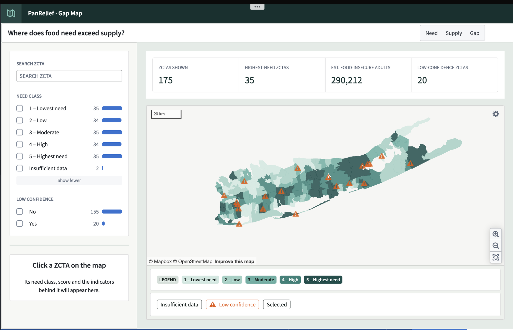

# Gap Map

**Where on Long Island is food needed most, and is it reaching those places?**

Gap Map shades every ZIP code area in Nassau and Suffolk counties by a modeled estimate of food insecurity, then compares that need to where food banks and pantries actually are. Built for PanRelief, a 501(c)(3), so it can direct food, volunteers, and outreach to the areas with the biggest gap.

*Need: each ZIP code area ranked from 1 (lowest need) to 5 (highest), combining CDC's modeled food-insecurity rate with seven Census indicators. Warning markers flag low-confidence areas. The supply and gap layers come next.*

## What you're looking at

- **Need:** the share of people in each ZIP code area who don't reliably have enough to eat.
- **Supply:** food banks, pantries, and agencies, with their hours and capacity.
- **Gap:** places where need is high and supply is low. These are the areas to act on first.

## How it was built

Palantir Foundry and Python, using only public data. Every design decision, pipeline, and intermediate map is in the session journal. Start at [`docs/`](docs/README.md).

Every line in this repo is written by hand.
