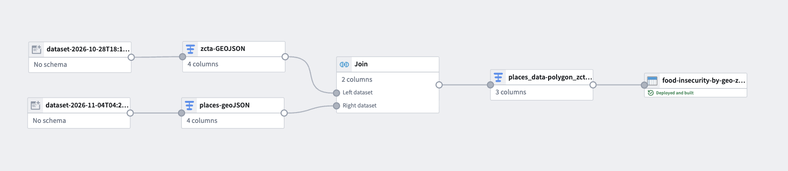
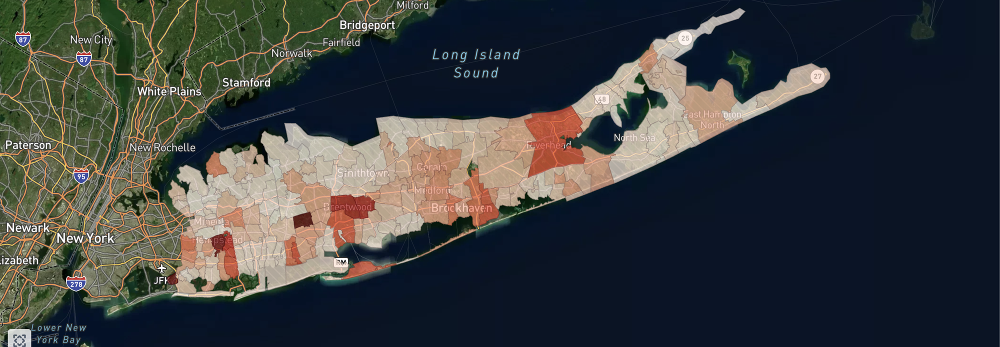

# 2026-11-04 · PLACES: need layer 1 (direct food insecurity)

## Found

CDC PLACES (2025 release, ZCTA, GIS-friendly format) is a national GeoJSON with one row per ZCTA, covering about 32.5k ZCTAs, and about 40 health and social measures for each, all estimated from CDC's BRFSS survey. Several measures are direct need measures:

- `foodinsecu`: food insecurity
- `foodstamp`: receiving SNAP
- `housinsecu`: housing insecurity

Each measure comes as a crude prevalence (`_crudeprev`) and a 95% confidence interval (`_crude95ci`).

Two things about the file shaped the work:
- **Geometry is a point (the ZCTA centroid), not a polygon.** It can't be shaded as an area on its own.
- **Every value is a string**, for example `"16.7"` and `"( 9.8, 13.3)"`.

## Decided

### Split need into two layers: direct, then indirect

- **Options:**
  1. One composite of every indicator from the start.
  2. A direct measure as its own layer, with indirect indicators added on top.
- **Choice:**
  - **Layer 1:** PLACES `foodinsecu_crudeprev`, mapped as is.
  - **Layer 2:** the indirect indicators (poverty, income, housing burden, and others), each z-scored across Long Island ZCTAs and combined.
- **Why:**
  - PLACES gives a defensible food-insecurity rate for every ZCTA right away, so there's a usable map before any weighting decisions.
  - Keeping it separate means layer 2 can be checked against it. Where the two disagree, the cause is either a data error or a real finding.
- **Consequences:**
  - PLACES is *modeled* from a survey, not observed, so it inherits BRFSS model assumptions.
  - Its food-insecurity, SNAP, and housing measures share one model, so they shouldn't count as independent indicators in layer 2.

### Keep PLACES properties, take geometry from TIGER

- **Options:**
  1. Filter PLACES by ZCTA code with pandas, then attach polygons.
  2. Do a geo-intersection join in Pipeline Builder: PLACES centroids inside TIGER ZCTA polygons, keeping the PLACES properties and the TIGER polygon geometry.
- **Choice:** the geo join in Pipeline Builder.
- **Why:** both datasets were already in Foundry, so there was no export and re-upload. Locally, a plain `zcta5` code match and a point-in-polygon join both returned the same **169** ZCTAs with no mismatches, so the spatial join doesn't change which areas are included.
- **Consequences:** PLACES has no rows for 4 Long Island ZCTAs (`11042`, `11931`, `11947`, `11973`). They look like very small or non-residential ZCTAs; PLACES drops ZCTAs with almost no population. They are holes in the map for now.

### One object per ZCTA, indicators as properties

- **Options:** a separate object type for each layer, or one ZCTA object type that collects properties as layers are added.
- **Choice:** one object per ZCTA. Primary key `zcta5`, geometry as a geoshape property, `food_insecurity_crude` as the first indicator.
- **Why:** every layer has the same grain. Layer 2 and the gap score become more properties on the same object, so nothing needs to be joined later.

### Choropleth, not heatmap

- **Choice:** shade each ZCTA polygon by its rate on a sequential scale, set to the Long Island min and max rather than 0–100.
- **Why:** this follows from [2026-10-11](../2026-10-11-area-rates-not-households/). Foundry's heatmap layer shows point density, which is the picture that entry rejected.

## Built

1. **Inputs:** the TIGER Long Island ZCTA GeoJSON (from [2026-10-25](../2026-10-25-zcta-polygons/)) and the PLACES ZCTA GeoJSON.
2. **Join:** PLACES points within TIGER polygons. Keep `properties` from PLACES and `geometry` from TIGER.
3. **Get struct field** from `properties`: `zcta5` and `foodinsecu_crudeprev` (renamed to `food_insecurity_crude`).
4. **Cast** `food_insecurity_crude` to double. PLACES stores numbers as strings, and both the color scale and the z-scores need real numbers.
5. **Select columns:** `zcta5`, `food_insecurity_crude`, `geometry`.
6. **Output:** dataset `food-insecurity-by-geo-zcta`, used as the backing dataset for the ZCTA object type, which is then layered onto a Foundry Map colored by `food_insecurity_crude`.

## Outcome

169 of 173 Long Island ZCTAs, each with a food-insecurity rate and its real boundary. Darker means a higher share of adults who are food insecure.

The darkest areas are around Hempstead, Brentwood, and Riverhead. Most of the North Shore is light.

## Open

- **Health checks aren't built yet.** Planned:
  - null count for `food_insecurity_crude`
  - prevalence range (roughly 3–40%; anything outside that is a parsing error)
  - CI width, median and 90th percentile (parse `foodinsecu_crude95ci` into lower and upper bounds)
  - ZCTAs with fewer than 500 adults, flagged as low confidence rather than dropped
  - duplicate `zcta5` count, which should be zero
- **The Long Island ZCTA list is missing `11549` (Hempstead/Hofstra) and `11709` (Bayville).** Both are in TIGER and PLACES, and both were in the original Nassau list. Add them to [`long_island_zctas.py`](../../../transforms/geography/long_island_zctas.py), then regenerate and re-upload the polygons.
- **The 4 ZCTAs not in PLACES** show as holes. Consider a left join from the ZCTA side so they appear as "no data".
- **Layer 2:** indirect indicators from ACS (child and senior poverty, severe housing burden, zero-vehicle households), z-scored across Long Island ZCTAs, with signs flipped so a higher value always means more need. Run a correlation check to drop double-counted indicators.

## Links

- Sources: CDC PLACES and Census TIGER rows in [`data/sources.md`](../../../data/sources.md)
- Builds on: [2026-10-25 ZCTA polygons](../2026-10-25-zcta-polygons/)
