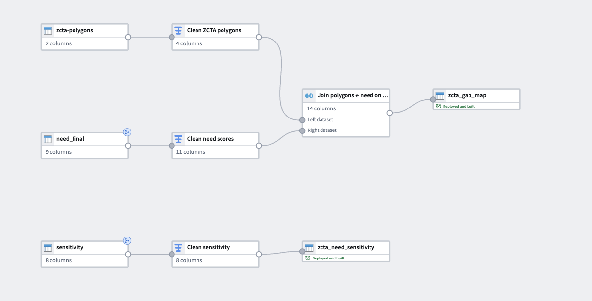
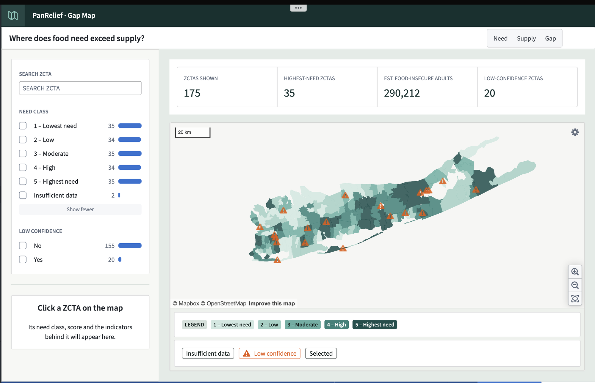

# 2026-11-10 · Need layer in Foundry

## Found

`need_final.csv` and `sensitivity.csv` from [the need score entry](../2026-11-10-need-score/) are ready to map: one row per ZCTA, 175 rows.

## Decided

### Polygons on the left of the join

- **Choice:** left join, ZCTA polygons ← need scores, on `zcta5`.
- **Why:** all 175 ZCTAs stay on the map, including the 2 with no score (11042, 11973). They show as "Insufficient data" instead of holes, which fixes the open item from [2026-11-04](../2026-11-04-places-need-layer-1/).

### Map need class, not need score

- **Choice:** color by `need_quintile`, 1 (lowest need) to 5 (highest), on a 5-step sequential scale.
- **Why:** a class is easier to act on than a z-score, and quintiles give 35 ZCTAs per class, so "highest need" always means the top fifth of Long Island.

### Show low confidence, don't hide it

- **Choice:** a warning marker on the 20 low-confidence ZCTAs, plus a filter.
- **Why:** they keep their class, but anyone directing food there should know the sources disagree or the data is thin.

### Sensitivity as its own dataset

- **Choice:** `sensitivity` goes to `zcta_need_sensitivity`, not into the map dataset.
- **Why:** it backs up the weight choice. The map only needs the final class.

## Built

1. **Inputs:** `zcta-polygons` (TIGER, from [2026-10-25](../2026-10-25-zcta-polygons/)), `need_final`, `sensitivity`.
2. **Clean ZCTA polygons:** pull `zcta5` and the polygon geometry out of the GeoJSON into their own columns.
3. **Clean need scores:** cast column types and add a need class label ("1 – Lowest need" to "5 – Highest need", or "Insufficient data") for the legend and filters.
4. **Join:** polygons left, need right, on `zcta5`. Output `zcta_gap_map`, 14 columns, backing the ZCTA object type.
5. **Clean sensitivity:** output `zcta_need_sensitivity`.
6. **Workshop app:** Gap Map, with Need, Supply and Gap tabs. Only Need is built.

## Outcome

- **175 ZCTAs shown:** 35 / 34 / 35 / 34 / 35 per class, 2 insufficient data.
- **290,212 estimated food-insecure adults,** matching the sum in `need_final.csv`.
- **20 low confidence,** matching the need score entry.

## Open

- Supply layer: pantry locations and hours.
- Gap layer: need minus supply.

## Links

Builds on [Need score: combine, test, finalize](../2026-11-10-need-score/) and [ZCTA polygons on a Foundry map](../2026-10-25-zcta-polygons/).
